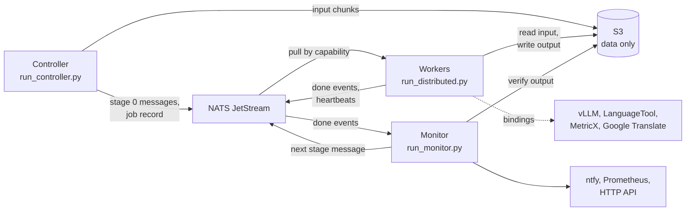

# DataCurator

[](pyproject.toml)
[](https://docs.astral.sh/uv/)
[](https://hydra.cc/)
[](https://docs.nats.io/nats-concepts/jetstream)
[](wiki/Home.md)
[](LICENSE)

A fault-tolerant pipeline for **translating, post-editing and quality-checking parallel text datasets with LLMs**,
on one machine or across an elastic fleet of GPU boxes.

**What it is.** DataCurator pushes every record of a dataset through an ordered list of stages: Google Translate
drafts, LLM review with structured output, LanguageTool checks, MetricX scoring, and rule-based guards. The goal is a
**zero-drop** workflow: weak samples get improved rather than thrown away, and a record that cannot be processed is
flagged with its error and kept in the output.

**What it is for: long, expensive LLM jobs on hardware that comes and goes.** The distributed pipeline splits a dataset
into small chunks and lets any number of workers pull them from a queue. You can add a worker mid-run, lose one without
losing the job, or give each stage a different model. Results live in S3 under keys derived from the stage's
configuration, so a rerun computes only what is missing for the current plan.

## Contents

- [Features](#features) · [How it works](#how-it-works) · [Quick start](#quick-start)
- [Operating a job](#operating-a-job) · [Failure handling](#failure-handling) · [Observability](#observability)
- [Experiments](#experiments) · [Stage toolkit](#stage-toolkit) · [Supporting services](#supporting-services) · [Helper tools](#helper-tools)
- [Single-machine mode](#single-machine-mode) · [Documentation](#documentation) · [Limitations](#limitations) · [License](#license)

## Features

- **Elastic fleet**: workers join and leave at any time. Stages have no global barrier, so chunk 42 can be on stage 3
  while chunk 43 is still on stage 1.
- **Capability routing**: a worker's tags come from its bindings file, and it pulls only the stages it can serve. A
  stage whose model has no worker simply waits in its queue.
- **Effectively-once results**: at-least-once delivery, an interchangeable recompute and one single-object S3 write per
  chunk leave exactly one well-formed output per chunk.
- **Cheap reruns**: stage signatures chain, so editing a stage recomputes that stage and everything after it, and reuses
  everything before it.
- **No config drift**: each message carries the rendered stage. Workers read no behaviour from local config, and only
  endpoints and credentials stay on the box.
- **Version fencing**: a worker on a different git commit never binds the job's consumers, so it pulls nothing.
- **Batched LLM requests**: a per-stage toggle packs N records into one completion. Outputs are matched back by an
  echoed item id, and only the failing items are re-sent.
- **Validator-driven correction**: rejected answers go back to the model in the same conversation, with concrete
  feedback such as the LanguageTool rule that fired or the character that went missing.
- **Per-record provenance**: every record carries a `_prov` list of the stage, worker, model, version, delivery attempt
  and time behind it.
- **Monitoring included**: ntfy alerts, Prometheus metrics, a provisioned Grafana dashboard, a read-only HTTP API and
  optional Loki log shipping.

## How it works



A unit of work is one **(stage, chunk)** pair. Messages only point at data: the data itself stays in S3, so the next
stage of a chunk can run on a different machine.

| Role | Entry point | Lifetime | Responsibility |
|---|---|---|---|
| **Controller** | `run_controller.py` | short, run by hand | Freezes record ids and chunk boundaries, uploads input, renders stage specs, seeds stage 0. Also handles rerun, cancel and cleanup. |
| **Monitor** | `run_monitor.py` | long, one instance | Checks each finished chunk in S3 and enqueues its next stage. Reconciles against S3, detects completion, sends alerts, serves metrics and the API. |
| **Worker** | `run_distributed.py` | long, one per box | Pulls, downloads, runs the stage, uploads, reports done, acks. It doesn't know the pipeline's topology. |

**Behaviour travels, bindings stay.** A message carries modifiers, prompt text, the response schema, validators,
sampling parameters and filters. API endpoints, keys and per-box serving limits come from the worker's environment and
bindings file. The controller refuses to seed a stage whose spec contains a binding key, and prompt files are read on
the controller, so workers never need them. Two boxes with different GPUs can share one job and its signatures.

**Output keys are addressed by plan.** Each stage writes to `stage/<NN>_<stage>/<sig>/chunk-<id>.jsonl`, where `sig`
hashes the code version, the previous stage's signature and the rendered stage spec. A missing key therefore always
means "missing for this exact plan", and a late worker from an older plan can only write under a dead prefix.

## Quick start

A deployment has a coordination box, one or more workers and an S3-compatible bucket. Clone the repository and run
`uv sync` on each box. Each role has its own template:
[`.env.monitor.example`](.env.monitor.example), [`.env.worker.example`](.env.worker.example) and
[`.env.controller.example`](.env.controller.example).

### Coordination box

`distributed-infra/docker-compose.yml` starts Prometheus and Grafana. Its `nats`, `monitor` and `loki` services are
present but commented out, so **uncomment `nats` first** unless NATS already runs elsewhere. NATS requires
authentication, with one user per node:

```bash
cp .env.monitor.example .env
cp distributed-infra/nats/nats-users.example.conf distributed-infra/nats/nats-users.conf
docker compose -f distributed-infra/docker-compose.yml up -d
uv run --env-file .env python run_monitor.py
```

Edit both copied files before starting. Prometheus scrapes the monitor at `host.docker.internal:8022`, so set
`DC_MONITOR_PORT=8022` and make sure the host firewall lets the Docker network reach that port. Set `GF_ADMIN_USER` and
`GF_ADMIN_PASSWORD` too, because Grafana otherwise uses `admin` / `admin` and allows anonymous viewers.

### Workers

Each worker runs bare on its box, from the same git commit as the job. The model server is started separately, for
example with [`scripts/run-qwen38.sh`](scripts/run-qwen38.sh). `bindings.yaml` maps model names to endpoints, and each
entry becomes a `model:<name>` capability. Without the file, the worker is CPU-only.

```bash
cp .env.worker.example .env
cp bindings.example.yaml bindings.yaml
uv run --env-file .env python run_distributed.py
```

[`bindings.example.yaml`](bindings.example.yaml) also sets per-box `concurrency` and `timeout` for each model, the Google
Translate endpoint and limits, and the LanguageTool and MetricX addresses. To run under systemd, use
[`scripts/dc-worker.service`](scripts/dc-worker.service). It loads `.env` through `EnvironmentFile`, which treats inline
comments as part of the value, so remove the `# in-flight records` comment from `DC_WORKER_CONCURRENCY` first.

### Seed a job

Seed a canary first, inspect its output, then re-seed without the flag to widen it to the full dataset. Finished chunks
are not recomputed. The experiment's prompts must be in `assets/prompts/<experiment>/` on the controller, as they are
kept out of git.

```bash
uv run python helpers/HF_mined_ds_to_jsonl_segments.py --out-prefix squadv2
uv run python run_controller.py seed gate_squadv2_qwen38_batching --max-chunks 5
uv run python helpers/browse_jsonl_s3.py --list
uv run python run_controller.py seed gate_squadv2_qwen38_batching
```

Chunks default to 20 records; change this with `--chunk-size`. Keep them small for expensive stages, because a worker
that dies near the end of a chunk reruns the whole chunk. Throughput is set separately by `DC_WORKER_CONCURRENCY`, the
number of records in flight per worker.

## Operating a job

| Command | What it does |
|---|---|
| `run_controller.py seed <experiment> [--max-chunks N] [--chunk-size N] [overrides]` | Prepares and enqueues a job. Safe to repeat, and takes Hydra overrides such as `dataset.input=data/x.jsonl`. |
| `run_controller.py status <job_id>` | Shows done, queued, unacked and redelivered counts per stage under the current signatures. |
| `run_controller.py rerun <job_id>` | Enqueues only what is missing, reading the stored plan rather than current config. |
| `run_controller.py rerun <job_id> --chunks 000042,000043 --force` | Deletes those chunks' outputs at every stage and recomputes them. |
| `run_controller.py cancel <job_id>` | Purges the queue and marks the job cancelled. In-flight chunks finish, and a monitor restart won't revive the job. |
| `run_controller.py gc <job_id>` | Deletes output prefixes from older plans. |

Run these as `uv run python run_controller.py`. The controller loads `.env` by itself; the monitor and worker do not,
hence `--env-file` above.

**Change a running job** by editing the experiment and running `seed` again. Changed stages and everything after them
get new signatures, unchanged earlier stages keep their outputs, and you don't need to wait for in-flight work. The
`input/` chunks are frozen on first seed, so changed source data, chunk size or `dataset.priority` needs a new job.

**Control processing order** with `dataset.priority`, which sorts records before they are cut into chunks. Low chunk ids
flow through first, so a joint run can finish its queries while documents are still drafting. The order is approximate,
since parallel workers and redeliveries shuffle it a little.

**Stop a worker gracefully** with `s` then Enter in its terminal, or with `SIGTERM`. It stops pulling, finishes its
in-flight chunks and exits, so nothing is redelivered. For a rolling upgrade, drain, deploy and restart box by box.

**Retry failed records** by turning them into a new experiment's input. A record counts as failed if the last stage holds
it with `error: true` or it never got there. Credentials come from `.env.browse`.

```bash
uv run python helpers/pull_failed_s3.py gate_squadv2_qwen38_batching --out data/squadv2_segments_flagged.jsonl
uv run python run_controller.py seed gate_squadv2_qwen38_batching_rerun
```

## Failure handling

| Failure | What happens | Bound |
|---|---|---|
| Worker dies | Its heartbeats stop and the chunk is redelivered to another worker. | 120 s lease |
| Worker loses its lease but survives | It aborts the chunk, and skips the upload if its last heartbeat is stale. | one heartbeat interval (30 s) |
| One record fails | The record is flagged with `error_type`, `error_stage`, its message and a traceback, keeps its fields and skips later stages. The rest of the chunk continues. | per record |
| LLM or service outage | More than 50% of a chunk flagged with connection-class errors counts as an outage: the worker naks instead of uploading. Validator rejections don't count. | backoff from 60 s, doubling, up to 15 min |
| S3 errors | Retried inline, then the chunk is nak'd with backoff. | 6 attempts per call (`DC_S3_RETRIES`) |
| Poison chunk | It dead-letters and triggers an alert naming the job, stage, chunk and workers. | 3 deliveries |
| Monitor dies | Handoff pauses and no data is at risk. On restart it rebuilds state from job records, done events and S3. | restart |
| Dead-letter missed while the monitor was down | A later check finds the job's queues empty but its chunks incomplete, and alerts with the chunk ids and the `rerun` command. | 3 reconcile passes |
| NATS loses its disk | Start a fresh NATS and seed again. Finished chunks are skipped, because S3 is the source of truth. | in-flight chunks rerun |

Done events are treated as hints: the monitor verifies the output in S3 before enqueueing the next stage, and reconciles
against S3 every 60 s. An output key either exists whole or not at all, even when filters leave a chunk empty.

## Observability

**Alerts** go to ntfy from the monitor. Set `NTFY_URL`, `NTFY_TOKEN` and `DC_NTFY_TOPIC`, and override any priority with
`DC_NTFY_PRIORITY_<KIND>`.

| Kind | Fires on | Default priority |
|---|---|---|
| `DEAD_LETTER` | A chunk ran out of deliveries, or a job drained without completing. | `high` |
| `GHOST` | A done event has no S3 object behind it. | `urgent` |
| `STALL` | Queued work has no capable worker. Sent hourly per job and stage, or as a `DC_STALL_CRON` digest. | `high` |
| `FLAGGED` | A spike of flagged records with one error type. | `default` |
| `REDELIVERY` | A spike of redeliveries, which suggests the lease is too tight or the event loop is blocked. | `default` |
| `COMPLETE` | The job finished. | `default` |

**Metrics.** The monitor is the only Prometheus target, at `/metrics` on `DC_MONITOR_PORT` (default 8080). Metrics include
per-stage chunks done, queue depth, redeliveries, dead letters, flagged records by error type, and each worker's in-flight
records, version, CPU, RAM and GPU use. Progress gauges refresh on the 60 s reconcile pass. Grafana provisions a
**Distributed Pipeline** dashboard on `:3000`.

**HTTP API.** All endpoints need `Authorization: Bearer $DC_PANEL_TOKEN`, and the API stays closed if no token is set.

| Endpoint | Returns |
|---|---|
| `GET /api/jobs` | A summary of every job. |
| `GET /api/jobs/{id}` | Per-stage progress, queues, flagged counts, dead-lettered chunks and the fleet. |
| `GET /api/jobs/{id}/artifacts` | The final stage's output keys under the current plan. |
| `GET /api/stream` | Server-sent events for changes as they happen. |

**Logs.** Set `DC_LOKI_URL` to push worker logs at WARNING and above to Loki. Shipping fails open, so a Loki outage can't
stall the pipeline. Log lines carry worker, job, stage, chunk and signature. Flagged records and `_prov` usually explain a
failure without opening a log at all.

## Experiments

An experiment is a Hydra file in [`config/experiment/`](config/experiment/) that declares an ordered `order` list and a
`pipeline` node per stage. Any stage can be switched off with `enabled: false`. Model presets for Qwen3.6, Qwen3.8,
Muse-Glimmer, Index-Translate and Bielik live in [`config/model/`](config/model/).

The shipped production flow, as in `gate_squadv2_qwen38_batching`:

| Stage | Type | What it does |
|---|---|---|
| `translate` | `GoogleTranslateStage` | Writes and persists the draft, so gate reruns never call the service again. |
| `gate_document` | LLM, batched | Annotates span-level issues and routes each draft. LanguageTool findings feed the prompt, and the verdict is recomputed from issue severities. MetricX and transfer checks can force a draft to the fix path. |
| `fix_document` | LLM, reprompting | Runs only on `needs_edit` records and writes two candidate rewrites, checked by validators. |
| `pick_the_best_translation` | LLM, batched | Chooses a candidate by id, so the model cannot alter the text while picking. |
| `finalize` | `CoalesceStage` | Writes the first available result to `final_translation`. |

Records outside a stage's filter ride through with `on_filtered: pass` and still reach the final file; `on_filtered: drop`
removes them. Batching is a stage-level setting and part of the signature, so tune it before seeding:

```yaml
pick_the_best_translation:
  enabled: true
  batch:
    size: 5
    on_failure: single
  filters:
    - _target_: DataCurator.pipeline.filters.ExpressionFilter
      expression: 'gate_answer.verdict == "needs_edit"'
      on_filtered: pass
```

Other shipped flows include joint query and document runs from one segments file (`gate_squadv2_*`), positives as
terminology context (`gate_queries_trivia_muse_batching_context`), span-level pair adjustment
(`adjust_squadv2_qwen38_batching`), dedicated translation-model drafts (`gate_queries_squadv2_index_translate_batching`) and
failure reruns (`*_rerun`).

## Stage toolkit

Every part below is configured with `_target_` in YAML. LLM prompts are Jinja2 templates, written inline or stored as
experiment assets.

| Part | Available | Role |
|---|---|---|
| **Stages** | `LLMStage`, `GoogleTranslateStage`, `CoalesceStage` | The work itself. `LLMStage` talks to any OpenAI-compatible endpoint and delivers its schema as `response_format` or a forced tool call (`structured_output`). |
| **Modifiers** | Google Translate, LanguageTool, MetricX score, transfer check, `SetWhen`, derive verdict, candidates, select by id, apply edits, rename, constants, list dedup / limit / pick | Run before or after a stage to enrich records, fetch signals or route them. |
| **Validators** | length ratio, character count, script consistency, pattern preservation, repetition, similarity, LanguageTool, MetricX, edit span | Reject a parsed answer whose content is wrong. |
| **Repairs** | `LanguageToolRepair` | Fix a mechanical defect, such as a doubled word, before validators run. |
| **Filters** | `ExpressionFilter` | Choose which records a stage runs, using a safe expression language that never calls `eval`. |

For retries, `reprompt_attempts` adds correction rounds in the same conversation, and `reprompt_on_truncation` gives
answers cut off at `max_tokens` a round too. `on_guard_failure: keep` stores a rejected answer so an `after` modifier can
route the record. In a batched stage, `on_failure: single` retries a failed batch's records one at a time, so one bad item
doesn't flag its batchmates.

An unreachable checker raises `ServiceUnavailableError`, which counts toward the outage breaker, so an outage doesn't get
written into your data as validator failures.

## Supporting services

| Service | Location | Purpose |
|---|---|---|
| **vLLM launchers** | [`scripts/run-*.sh`](scripts/) | Serving commands for the Qwen, Muse-Glimmer and Index-Translate models. |
| **MetricX** | [`inference/metricx/`](inference/metricx/README.md) | Keeps a translation-quality model warm on a GPU with dynamic batching. Scores are 0–25, lower is better. Port 8023. |
| **LaBSE** | [`inference/labse/`](inference/labse/README.md) | Sentence embeddings with the same batching design, for margin-based pair filtering. Port 8024. |
| **LanguageTool** | [`languagetool/`](languagetool/docker-compose.yml) | Four load-balanced replicas behind Traefik. |
| **vLLM dashboard** | [`grafana/`](grafana/docker-compose.yml) | A separate Prometheus and Grafana stack for vLLM metrics. |
| **LiteLLM proxy** | [`litellm-proxy/`](litellm-proxy/docker-compose.yml) | A proxy config for swapping backends behind one endpoint. |

## Helper tools

| Tool | Purpose |
|---|---|
| `helpers/browse_jsonl_s3.py` | Terminal browser for results in S3. `--list` shows browsable prefixes. |
| `helpers/browse_jsonl.py` | The same browser for a local JSONL file. |
| `helpers/pull_failed_s3.py` | Collects a job's failed records as input for a rerun. |
| `helpers/combine_experiments.py` | Merges experiments by record id, healing errors. |
| `helpers/fill_translations_from_HF.py` | Fills translation gaps from a HuggingFace dataset. |
| `helpers/HF_mined_ds_to_jsonl*.py` | Convert mined-negatives datasets to pipeline input. |
| `helpers/jsonl_to_HF_mined_ds.py` | Re-attaches translated records to the HuggingFace dataset. |
| `helpers/margin_score_jsonl.py` | Margin-based scoring of bilingual pairs, with cached embeddings so reruns are cheap. |
| `metricx/` | Standalone offline MetricX scoring and system comparison, in an isolated environment. |
| `scripts/probe_*.py` | Calibrate LanguageTool rules, MetricX thresholds and transfer checks on real data. |

## Single-machine mode

`run_pipeline.py` runs the same stages in one process with local JSONL output, which suits smoke tests and small datasets.
It resumes by skipping records already processed under an unchanged stage config. It reads the Google Translate
endpoint from `GOOGLE_TRANSLATE_URL` and `GOOGLE_TRANSLATE_CLIENT` in `.env`.

```bash
uv run python run_pipeline.py experiment=documents_trivia_no_thinking dataset.limit=200
uv run python run_pipeline.py experiment=documents_trivia_no_thinking runner.start_from=pick_the_best_translation
uv run python run_pipeline.py experiment=documents_trivia_no_thinking pipeline.pick_the_best_translation.enabled=false
```

These need the experiment's input file and prompt assets, plus a reachable model server.

Other options are `runner.pause_between_stages` for manual model swaps and `reporting=s3` for job status reporting.
Batching, capability routing and `on_filtered` exist only on the fleet. The standalone runner ignores `batch:` and rejects
`on_filtered`, so the gated experiments can't run locally.

## Documentation

| | |
|---|---|
| [Getting started](wiki/Getting-Started.md) · [Configuration](wiki/Configuration.md) | Install and first run; every config key and environment variable. |
| [Distributed pipeline](wiki/Distributed.md) | The full design: wire format, invariants, leases, routing, batching and observability. |
| [Components](wiki/Components.md) | Stages, modifiers, filters, validators, prompts and individual experiments. |
| [MetricX evaluation](wiki/metricX.md) · [Margin similarity](wiki/MarginBasedSimilarity.md) | Offline quality scoring; margin-based pair filtering (in Polish). |
| [Infrastructure](distributed-infra/README.md) · [Job panel](job-panel/README.md) | The compose stacks, including a local NATS and MinIO harness; the specification for a job dashboard. |

To run the tests: `uv run pytest`.

## Limitations

- **Per-record stages only.** The pipeline is linear, and stages can't look across records, so there is no global dedup
  or corpus statistics stage.
- **Recomputes are equivalent, not identical.** LLM stages sample, so a rerun gives an equally valid output rather than
  the same bytes. A worker that loses its lease can occasionally overwrite an output with its own valid version. `_prov`
  makes that visible, but it isn't prevented, because Garage has no conditional writes.
- **One monitor, one NATS.** Neither is replicated. Failure stalls progress but can't lose data, which is all in S3.
- **Prompts are not in the repository.** Experiments that use prompt files need their assets on the controller, so a
  fresh clone can't run the production experiments until those are in place.
- **Thresholds need calibrating.** Some shipped values, such as the MetricX gate override, are placeholders. Calibrate
  them with `scripts/probe_*.py` before a real run.
- **No provisioning.** Starting machines, deploying code and starting model servers are up to the operator.
- **No dashboard yet.** The repository specifies a job panel and ships the API behind it, but not the panel itself.

## License

GNU General Public License v3.0. See [LICENSE](LICENSE).
